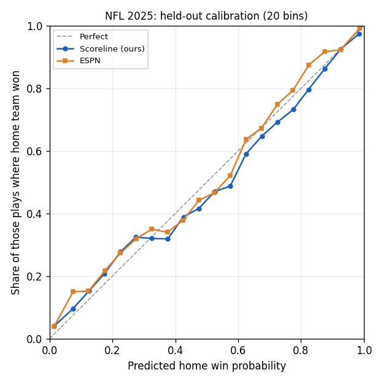
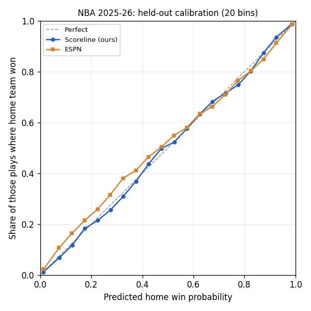
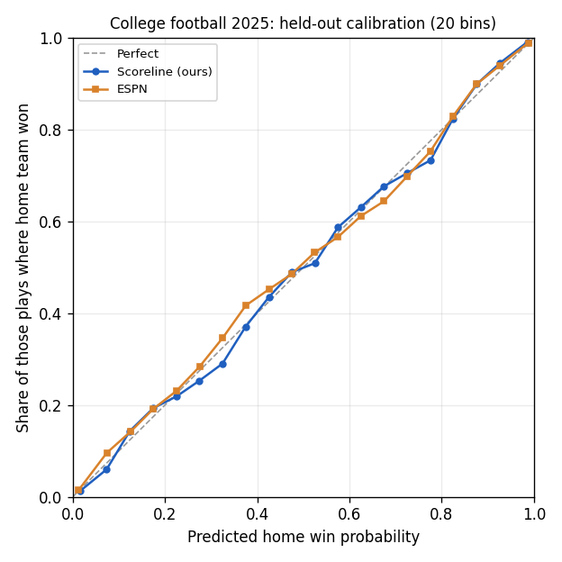
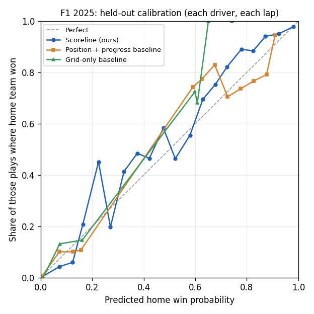

# Scoreline win probability: models and backtest

## Summary

| Sport | Latest held-out season | Brier ours / ESPN | Log loss ours / ESPN | 3 seasons pooled: Brier ours / ESPN (95% CI of gap) | Verdict |
|---|---|---|---|---|---|
| NFL | 50,013 plays, 284 games | 0.1621 / 0.1634 | 0.4834 / 0.4865 | 0.1545 / 0.1534 (-0.0029 to +0.0047) | **show ESPN's** |
| NBA | 640,036 plays, 1,317 games | 0.1461 / 0.1473 | 0.4381 / 0.4414 | 0.1483 / 0.1482 (-0.0016 to +0.0016) | **show ESPN's** |
| College football | 141,351 plays, 807 games | 0.1244 / 0.1255 | 0.3789 / 0.3816 | 0.1269 / 0.1253 (-0.0007 to +0.0038) | **show ESPN's** |
| F1 | 1,419 lap snapshots (24 races); Brier 0.2788 vs best baseline 0.3611 (no ESPN F1 number) | | | | **ship ours (no ESPN number exists)** |

## NFL

**Data.** nflverse play-by-play (CC-BY 4.0, credit: nflverse), regular season and playoffs. Training: 2006-2024 (5,133 games, 814,066 snaps and kickoffs; 2024 was used for early stopping, then folded back in). Held out: the 2025 season (284 games). Pre-game strength: Scoreline's own Elo from nflverse game results since 1999 (k=20, home edge 50 Elo points, 50% regression between seasons; pre-game log loss 0.6297 on 6,200 training-era games). No betting lines are used as inputs.

**Model.** Gradient-boosted trees (LightGBM, 444 trees, 15 leaves, monotone in score margin, strength, field position and timeouts), exported to plain JSON and evaluated in `models/wp.js`. Inputs: score margin, game and half seconds left, overtime, down, distance, yards to the end zone, home/away/neutral, timeouts left for both teams, pre-game strength, strength x time left, margin / time left.

### Held-out 2025: ours vs ESPN on ESPN's own plays

Both models are scored on exactly the same moments: right after each play that ESPN published a win probability for. Our input is built from ESPN's play-by-play the same way the app will build it live.

| Model | Brier (lower is better) | Log loss (lower is better) |
|---|---|---|
| Scoreline (ours) | **0.1621** | **0.4834** |
| ESPN | 0.1634 | 0.4865 |

50,013 plays from 284 games. Brier difference (ours minus ESPN): -0.0013, 95% CI -0.0072 to +0.0048 (bootstrap over games).

| Period | Plays | Brier ours | Brier ESPN |
|---|---|---|---|
| Q1 | 10,308 | 0.2134 | 0.2149 |
| Q2 | 14,338 | 0.1857 | 0.1869 |
| Q3 | 11,039 | 0.1525 | 0.1533 |
| Q4 | 14,041 | 0.1077 | 0.1092 |
| OT | 287 | 0.1779 | 0.1842 |

**Swings check** (change in home win probability from one play to the next, same game):

| Model | Mean change per play | 99th percentile | Plays with a change over 25 points |
|---|---|---|---|
| Scoreline (ours) | 2.13 pts | 16.3 pts | 0.22% |
| ESPN | 2.13 pts | 15.4 pts | 0.26% |

Calibration table (10 bins): predicted vs actual home win share.

| Bin | Ours: predicted / actual | ESPN: predicted / actual |
|---|---|---|
| 0-10% | 3.5% / 5.9% (n=5,542) | 3.4% / 7.5% (n=5,312) |
| 10-20% | 15.0% / 18.0% (n=3,256) | 14.9% / 18.3% (n=3,259) |
| 20-30% | 25.2% / 30.3% (n=3,982) | 25.4% / 29.9% (n=4,160) |
| 30-40% | 35.0% / 31.9% (n=4,151) | 35.1% / 34.5% (n=4,946) |
| 40-50% | 45.1% / 40.3% (n=4,539) | 45.1% / 41.1% (n=5,569) |
| 50-60% | 55.0% / 47.9% (n=5,005) | 54.9% / 49.3% (n=5,482) |
| 60-70% | 65.0% / 61.9% (n=5,185) | 64.9% / 65.5% (n=5,166) |
| 70-80% | 74.9% / 71.2% (n=4,748) | 75.0% / 77.2% (n=4,843) |
| 80-90% | 85.0% / 83.0% (n=4,693) | 85.0% / 89.6% (n=4,131) |
| 90-100% | 96.8% / 96.0% (n=8,912) | 96.9% / 97.2% (n=7,145) |

Latest season alone, the automatic check says: show ESPN's (ours scores slightly better but the gap is within bootstrap noise, so it is not measurably better). The verdict below uses all held-out seasons.

### Rolling backtest: 2023, 2024 and 2025 (each season predicted by a model trained only on earlier seasons)

| Held-out season | Games | Plays | Brier ours | Brier ESPN | Log loss ours | Log loss ESPN |
|---|---|---|---|---|---|---|
| 2023 | 285 | 52,000 | 0.1576 | 0.1525 | 0.4741 | 0.4582 |
| 2024 | 285 | 51,721 | 0.1441 | 0.1447 | 0.4318 | 0.4352 |
| 2025 | 284 | 50,013 | 0.1621 | 0.1634 | 0.4834 | 0.4865 |
| **All 3 pooled** | 854 | 153,734 | **0.1545** | 0.1534 | **0.4629** | 0.4597 |

Pooled Brier difference (ours minus ESPN): +0.0011, 95% CI -0.0029 to +0.0047 (bootstrap over games). Ours is better on both metrics in 2 of 3 seasons.

**Automatic verdict: show ESPN's.** ESPN's numbers score better than ours across the held-out seasons; show ESPN's number, labelled as ESPN's.

### Held-out 2025: ours vs nflverse on nflverse plays (before each snap)

| Model | Brier (lower is better) | Log loss (lower is better) |
|---|---|---|
| Scoreline (ours) | **0.1637** | **0.4876** |
| nflverse wp | 0.1724 | 0.5079 |

43,523 plays from 284 games. Brier difference (ours minus nflverse wp): -0.0087, 95% CI -0.0182 to +0.0003 (bootstrap over games).

| Model | Brier (lower is better) | Log loss (lower is better) |
|---|---|---|
| Scoreline (ours) | **0.1637** | **0.4876** |
| nflverse vegas_wp (uses the betting spread) | 0.1597 | 0.4791 |

43,523 plays from 284 games. Brier difference (ours minus nflverse vegas_wp (uses the betting spread)): +0.0040, 95% CI -0.0016 to +0.0104 (bootstrap over games).

## NBA

**Data.** sportsdataverse/hoopR ESPN play-by-play releases. Training: 2015-16 to 2024-25 (12,848 games, 5,989,494 plays; the last of those seasons was used for early stopping, then folded back in). Held out: 2025-26 including playoffs. Pre-game strength: Scoreline's own Elo from final scores (k=20, home edge 55, 40% regression between seasons; pre-game log loss 0.6268). No betting lines are used.

**Model.** Gradient-boosted trees (159 trees, 31 leaves, monotone in margin, possession and strength). Inputs: margin, seconds left, overtime, period, who has the ball (inferred from the last play), pre-game strength, strength x time left, margin / sqrt(time left).

### Held-out 2025-26: ours vs ESPN on ESPN's own plays

| Model | Brier (lower is better) | Log loss (lower is better) |
|---|---|---|
| Scoreline (ours) | **0.1461** | **0.4381** |
| ESPN | 0.1473 | 0.4414 |

640,036 plays from 1,317 games. Brier difference (ours minus ESPN): -0.0012, 95% CI -0.0037 to +0.0011 (bootstrap over games).

| Period | Plays | Brier ours | Brier ESPN |
|---|---|---|---|
| Q1 | 151,382 | 0.1981 | 0.1975 |
| Q2 | 163,471 | 0.1731 | 0.1748 |
| Q3 | 157,877 | 0.1367 | 0.1387 |
| Q4 | 163,408 | 0.0799 | 0.0814 |
| OT | 3,898 | 0.1419 | 0.1538 |

**Swings check** (change in home win probability from one play to the next, same game):

| Model | Mean change per play | 99th percentile | Plays with a change over 25 points |
|---|---|---|---|
| Scoreline (ours) | 1.08 pts | 7.4 pts | 0.03% |
| ESPN | 1.60 pts | 9.3 pts | 0.04% |

Calibration table (10 bins): predicted vs actual home win share.

| Bin | Ours: predicted / actual | ESPN: predicted / actual |
|---|---|---|
| 0-10% | 2.7% / 2.5% (n=76,305) | 2.9% / 4.4% (n=91,648) |
| 10-20% | 15.0% / 15.0% (n=37,858) | 15.0% / 19.0% (n=44,583) |
| 20-30% | 25.1% / 23.6% (n=46,131) | 25.1% / 28.9% (n=46,333) |
| 30-40% | 35.1% / 34.1% (n=52,118) | 35.0% / 39.7% (n=47,870) |
| 40-50% | 44.9% / 46.7% (n=55,626) | 45.0% / 48.5% (n=50,734) |
| 50-60% | 55.0% / 55.0% (n=56,169) | 55.0% / 56.5% (n=52,780) |
| 60-70% | 65.0% / 65.8% (n=59,175) | 65.1% / 65.0% (n=54,710) |
| 70-80% | 75.2% / 73.3% (n=68,761) | 75.1% / 73.8% (n=58,192) |
| 80-90% | 84.9% / 83.7% (n=73,155) | 85.1% / 82.7% (n=64,410) |
| 90-100% | 97.0% / 97.5% (n=114,738) | 97.0% / 96.6% (n=128,776) |

Latest season alone, the automatic check says: show ESPN's (ours scores slightly better but the gap is within bootstrap noise, so it is not measurably better). The verdict below uses all held-out seasons.

### Rolling backtest: three most recent seasons (each predicted by a model trained only on earlier seasons)

| Held-out season | Games | Plays | Brier ours | Brier ESPN | Log loss ours | Log loss ESPN |
|---|---|---|---|---|---|---|
| 2023-24 | 1,318 | 613,470 | 0.1473 | 0.1461 | 0.4432 | 0.4413 |
| 2024-25 | 1,321 | 624,637 | 0.1515 | 0.1513 | 0.4526 | 0.4530 |
| 2025-26 | 1,317 | 640,036 | 0.1461 | 0.1473 | 0.4381 | 0.4414 |
| **All 3 pooled** | 3,956 | 1,878,143 | **0.1483** | 0.1482 | **0.4446** | 0.4452 |

Pooled Brier difference (ours minus ESPN): +0.0000, 95% CI -0.0016 to +0.0016 (bootstrap over games). Ours is better on both metrics in 1 of 3 seasons.

**Automatic verdict: show ESPN's.** ESPN's numbers score better than ours across the held-out seasons; show ESPN's number, labelled as ESPN's.

## College football

**Data.** ESPN play-by-play (summary endpoint) for FBS games, 2017-2024 for training (5,903 games, 1,054,294 plays; 2024 used for early stopping, then folded back in). Game lists and final scores: sportsdataverse `cfb_schedules` releases (2004 on). Held out: the 2025 season (807 FBS games with ESPN win probability). We used ESPN's own play-by-play instead of the cfbfastR play files because the current cfbfastR release is built from a different (NCAA) feed whose field conventions don't match what the app receives live; training on the same feed the app uses avoids that mismatch. Pre-game strength: Scoreline's own Elo over all divisions (k=40, home edge 55, 20% regression; FBS start 1500, FCS 1250, others 1000; pre-game log loss 0.5103). No betting lines.

**Model.** Gradient-boosted trees (208 trees, 15 leaves). Same inputs as NFL minus timeouts (not reliably in the college feed) plus the period number (overtime rules change by period). Kickoff and extra-point moments are treated as the receiving team's 1st and 10 at its own 25.

### Held-out 2025: ours vs ESPN on ESPN's own plays

| Model | Brier (lower is better) | Log loss (lower is better) |
|---|---|---|
| Scoreline (ours) | **0.1244** | **0.3789** |
| ESPN | 0.1255 | 0.3816 |

141,351 plays from 807 games. Brier difference (ours minus ESPN): -0.0011, 95% CI -0.0051 to +0.0029 (bootstrap over games).

| Period | Plays | Brier ours | Brier ESPN |
|---|---|---|---|
| Q1 | 31,445 | 0.1735 | 0.1695 |
| Q2 | 40,417 | 0.1401 | 0.1405 |
| Q3 | 32,348 | 0.1090 | 0.1126 |
| Q4 | 36,826 | 0.0779 | 0.0819 |
| OT | 315 | 0.2151 | 0.2316 |

**Swings check** (change in home win probability from one play to the next, same game):

| Model | Mean change per play | 99th percentile | Plays with a change over 25 points |
|---|---|---|---|
| Scoreline (ours) | 1.98 pts | 15.9 pts | 0.28% |
| ESPN | 1.83 pts | 15.2 pts | 0.33% |

Calibration table (10 bins): predicted vs actual home win share.

| Bin | Ours: predicted / actual | ESPN: predicted / actual |
|---|---|---|
| 0-10% | 3.4% / 2.9% (n=17,850) | 3.0% / 3.8% (n=18,978) |
| 10-20% | 14.8% / 16.5% (n=9,482) | 14.9% / 16.6% (n=9,731) |
| 20-30% | 25.0% / 23.0% (n=8,636) | 25.0% / 25.7% (n=8,666) |
| 30-40% | 35.0% / 33.2% (n=8,868) | 35.0% / 38.2% (n=9,086) |
| 40-50% | 45.1% / 46.1% (n=9,474) | 45.1% / 46.9% (n=9,402) |
| 50-60% | 55.1% / 55.8% (n=10,340) | 55.0% / 55.0% (n=9,691) |
| 60-70% | 65.1% / 65.2% (n=11,728) | 65.0% / 62.8% (n=10,395) |
| 70-80% | 75.2% / 71.3% (n=11,851) | 75.2% / 72.7% (n=11,726) |
| 80-90% | 85.3% / 86.5% (n=14,062) | 85.1% / 86.5% (n=13,816) |
| 90-100% | 97.1% / 98.1% (n=39,060) | 97.3% / 97.7% (n=39,860) |

Latest season alone, the automatic check says: show ESPN's (ours scores slightly better but the gap is within bootstrap noise, so it is not measurably better). The verdict below uses all held-out seasons.

### Rolling backtest: 2023, 2024 and 2025 (each season predicted by a model trained only on earlier seasons)

| Held-out season | Games | Plays | Brier ours | Brier ESPN | Log loss ours | Log loss ESPN |
|---|---|---|---|---|---|---|
| 2023 | 787 | 135,634 | 0.1228 | 0.1201 | 0.3800 | 0.3745 |
| 2024 | 783 | 137,253 | 0.1335 | 0.1303 | 0.4061 | 0.3989 |
| 2025 | 807 | 141,351 | 0.1244 | 0.1255 | 0.3789 | 0.3816 |
| **All 3 pooled** | 2,377 | 414,238 | **0.1269** | 0.1253 | **0.3883** | 0.3850 |

Pooled Brier difference (ours minus ESPN): +0.0016, 95% CI -0.0007 to +0.0038 (bootstrap over games). Ours is better on both metrics in 1 of 3 seasons.

**Automatic verdict: show ESPN's.** ESPN's numbers score better than ours across the held-out seasons; show ESPN's number, labelled as ESPN's.

## F1

**Data.** OpenF1 lap times, pit stops and race-control messages (CC BY-NC-SA 4.0; OpenF1 history starts in 2023) for every Grand Prix 2023-2025 that loaded, plus grid slots, race distance and winners from Jolpica-F1 (CC BY-NC-SA 4.0). Sprints excluded. FastF1 was tried first, but the F1 live-timing archive it reads now returns 401 Unauthorized, so it could not be used. Safety car, VSC and red flag laps come from race-control messages. Training: 2023-2024 (46 races, 2,769 lap snapshots, 51,285 driver-laps). Held out: 2025 (24 races, 1,419 lap snapshots, 26,325 driver-laps).

**Model.** Conditional logit: each driver gets a score from position, gap to the leader per lap left, the same under a safety car / VSC / red flag, grid slot fading with race progress, pit stops made versus the leader, and the raw gap; the win probabilities are the softmax of the scores over the drivers still running, so they always sum to 100%. 10 weights in `models/wp-f1.json`.

### Held-out 2025

There is no ESPN F1 win probability and the app shows none today, so the comparison is against two simple baselines fitted on the same training races. Brier = sum over drivers of (p - won)^2 per lap snapshot, averaged; log loss = -log(probability given to the eventual winner).

| Model | Brier (lower is better) | Log loss (lower is better) |
|---|---|---|
| Scoreline (ours) | **0.2788** | **0.5812** |
| Grid only (pre-race order, never updates) | 0.4776 | 1.0166 |
| Position + race progress | 0.3611 | 0.7750 |

**Swings check:** mean change per driver per lap 0.62 pts (99th pct 12.3 pts); position + progress baseline 0.50 pts (99th pct 7.3 pts).

| Bin | Driver-laps | Predicted | Actual win share |
|---|---|---|---|
| 0-10% | 23,748 | 0.6% | 0.3% |
| 10-20% | 949 | 13.6% | 10.2% |
| 20-30% | 122 | 25.2% | 30.3% |
| 30-40% | 62 | 35.1% | 45.2% |
| 40-50% | 127 | 45.8% | 54.3% |
| 50-60% | 123 | 54.8% | 50.4% |
| 60-70% | 213 | 66.5% | 73.7% |
| 70-80% | 303 | 75.0% | 85.5% |
| 80-90% | 418 | 84.6% | 90.9% |
| 90-100% | 260 | 95.4% | 96.5% |

**Automatic verdict: ship ours (no ESPN number exists).**
