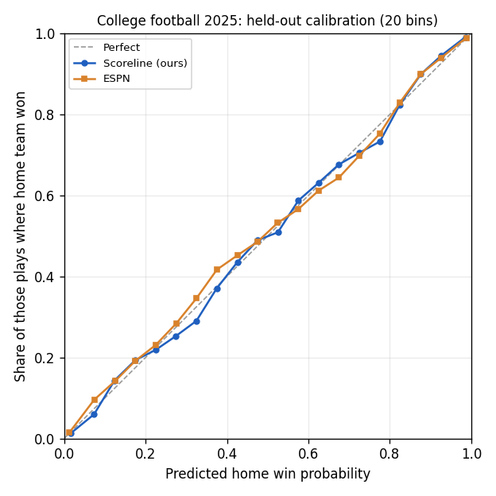

## College football

**Data.** ESPN play-by-play (summary endpoint) for FBS games, 2017-2024 for training (5,903 games, 1,054,294 plays; 2024 used for early stopping, then folded back in). Game lists and final scores: sportsdataverse `cfb_schedules` releases (2004 on). Held out: the 2025 season (807 FBS games with ESPN win probability). We used ESPN's own play-by-play instead of the cfbfastR play files because the current cfbfastR release is built from a different (NCAA) feed whose field conventions don't match what the app receives live; training on the same feed the app uses avoids that mismatch. Pre-game strength: Scoreline's own Elo over all divisions (k=40, home edge 40, 20% regression; FBS start 1500, FCS 1250, others 1000; pre-game log loss 0.5105). No betting lines.

**Model.** Gradient-boosted trees (201 trees, 15 leaves). Same inputs as NFL minus timeouts (not reliably in the college feed) plus the period number (overtime rules change by period). Kickoff and extra-point moments are treated as the receiving team's 1st and 10 at its own 25.

### Held-out 2025: ours vs ESPN on ESPN's own plays

| Model | Brier (lower is better) | Log loss (lower is better) |
|---|---|---|
| Scoreline (ours) | **0.1246** | **0.3797** |
| ESPN | 0.1255 | 0.3816 |

141,351 plays from 807 games. Brier difference (ours minus ESPN): -0.0009, 95% CI -0.0047 to +0.0031 (bootstrap over games).

| Period | Plays | Brier ours | Brier ESPN |
|---|---|---|---|
| Q1 | 31,445 | 0.1736 | 0.1695 |
| Q2 | 40,417 | 0.1403 | 0.1405 |
| Q3 | 32,348 | 0.1095 | 0.1126 |
| Q4 | 36,826 | 0.0781 | 0.0819 |
| OT | 315 | 0.2159 | 0.2316 |

**Swings check** (change in home win probability from one play to the next, same game):

| Model | Mean change per play | 99th percentile | Plays with a change over 25 points |
|---|---|---|---|
| Scoreline (ours) | 1.95 pts | 15.8 pts | 0.28% |
| ESPN | 1.83 pts | 15.2 pts | 0.33% |

Calibration table (10 bins): predicted vs actual home win share.

| Bin | Ours: predicted / actual | ESPN: predicted / actual |
|---|---|---|
| 0-10% | 3.4% / 2.8% (n=18,023) | 3.0% / 3.8% (n=18,978) |
| 10-20% | 14.7% / 16.6% (n=9,442) | 14.9% / 16.6% (n=9,731) |
| 20-30% | 24.9% / 23.5% (n=8,555) | 25.0% / 25.7% (n=8,666) |
| 30-40% | 35.0% / 33.1% (n=8,629) | 35.0% / 38.2% (n=9,086) |
| 40-50% | 45.1% / 46.3% (n=9,225) | 45.1% / 46.9% (n=9,402) |
| 50-60% | 55.1% / 54.9% (n=10,511) | 55.0% / 55.0% (n=9,691) |
| 60-70% | 65.1% / 65.5% (n=11,879) | 65.0% / 62.8% (n=10,395) |
| 70-80% | 75.1% / 72.0% (n=12,204) | 75.2% / 72.7% (n=11,726) |
| 80-90% | 85.2% / 86.4% (n=14,018) | 85.1% / 86.5% (n=13,816) |
| 90-100% | 97.1% / 98.0% (n=38,865) | 97.3% / 97.7% (n=39,860) |

**Automatic verdict: show ESPN's.** Ours scores slightly better but the gap is within bootstrap noise, so it is not measurably better; show ESPN's number, labelled as ESPN's.
