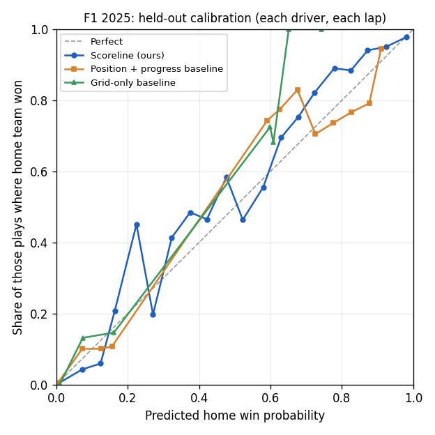

## F1

**Data.** OpenF1 lap times, pit stops and race-control messages (CC BY-NC-SA 4.0; OpenF1 history starts in 2023) for every Grand Prix 2023-2025 that loaded, plus grid slots, race distance and winners from Jolpica-F1 (CC BY-NC-SA 4.0). Sprints excluded. FastF1 was tried first, but the F1 live-timing archive it reads now returns 401 Unauthorized, so it could not be used. Safety car, VSC and red flag laps come from race-control messages. Training: 2023-2024 (46 races, 2,769 lap snapshots, 51,285 driver-laps). Held out: 2025 (24 races, 1,419 lap snapshots, 26,325 driver-laps).

**Model.** Conditional logit: each driver gets a score from position, gap to the leader per lap left, the same under a safety car / VSC / red flag, grid slot fading with race progress, pit stops made versus the leader, and the raw gap; the win probabilities are the softmax of the scores over the drivers still running, so they always sum to 100%. 10 weights in `models/wp-f1.json`.

### Held-out 2025

There is no ESPN F1 win probability and the app shows none today, so the comparison is against two simple baselines fitted on the same training races. Brier = sum over drivers of (p - won)^2 per lap snapshot, averaged; log loss = -log(probability given to the eventual winner).

| Model | Brier (lower is better) | Log loss (lower is better) |
|---|---|---|
| Scoreline (ours) | **0.2788** | **0.5812** |
| Grid only (pre-race order, never updates) | 0.4776 | 1.0166 |
| Position + race progress | 0.3611 | 0.7750 |

**Swings check:** mean change per driver per lap 0.62 pts (99th pct 12.3 pts); position + progress baseline 0.50 pts (99th pct 7.3 pts).

| Bin | Driver-laps | Predicted | Actual win share |
|---|---|---|---|
| 0-10% | 23,748 | 0.6% | 0.3% |
| 10-20% | 949 | 13.6% | 10.2% |
| 20-30% | 122 | 25.2% | 30.3% |
| 30-40% | 62 | 35.1% | 45.2% |
| 40-50% | 127 | 45.8% | 54.3% |
| 50-60% | 123 | 54.8% | 50.4% |
| 60-70% | 213 | 66.5% | 73.7% |
| 70-80% | 303 | 75.0% | 85.5% |
| 80-90% | 418 | 84.6% | 90.9% |
| 90-100% | 260 | 95.4% | 96.5% |

**Automatic verdict: ship ours (no ESPN number exists).**
