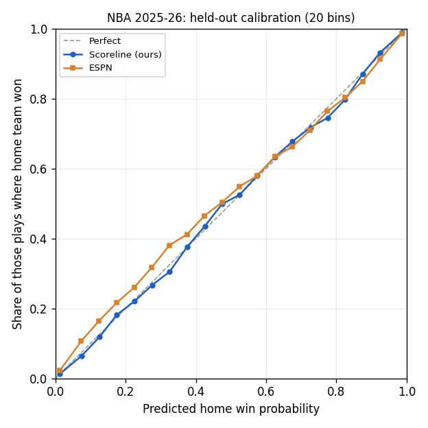

## NBA

**Data.** sportsdataverse/hoopR ESPN play-by-play releases. Training: 2015-16 to 2024-25 (12,848 games, 5,989,494 plays; the last of those seasons was used for early stopping, then folded back in). Held out: 2025-26 including playoffs. Pre-game strength: Scoreline's own Elo from final scores (k=20, home edge 40, 40% regression between seasons; pre-game log loss 0.6269). No betting lines are used.

**Model.** Gradient-boosted trees (208 trees, 15 leaves, monotone in margin, possession and strength). Inputs: margin, seconds left, overtime, period, who has the ball (inferred from the last play), pre-game strength, strength x time left, margin / sqrt(time left).

### Held-out 2025-26: ours vs ESPN on ESPN's own plays

| Model | Brier (lower is better) | Log loss (lower is better) |
|---|---|---|
| Scoreline (ours) | **0.1463** | **0.4388** |
| ESPN | 0.1473 | 0.4415 |

637,996 plays from 1,313 games. Brier difference (ours minus ESPN): -0.0010, 95% CI -0.0035 to +0.0015 (bootstrap over games).

| Period | Plays | Brier ours | Brier ESPN |
|---|---|---|---|
| Q1 | 150,914 | 0.1988 | 0.1977 |
| Q2 | 162,953 | 0.1734 | 0.1748 |
| Q3 | 157,357 | 0.1370 | 0.1388 |
| Q4 | 162,874 | 0.0800 | 0.0813 |
| OT | 3,898 | 0.1406 | 0.1538 |

**Swings check** (change in home win probability from one play to the next, same game):

| Model | Mean change per play | 99th percentile | Plays with a change over 25 points |
|---|---|---|---|
| Scoreline (ours) | 1.09 pts | 7.6 pts | 0.03% |
| ESPN | 1.60 pts | 9.3 pts | 0.04% |

Calibration table (10 bins): predicted vs actual home win share.

| Bin | Ours: predicted / actual | ESPN: predicted / actual |
|---|---|---|
| 0-10% | 2.7% / 2.5% (n=76,487) | 2.9% / 4.4% (n=91,147) |
| 10-20% | 15.1% / 15.2% (n=38,036) | 15.0% / 19.1% (n=44,231) |
| 20-30% | 25.0% / 24.4% (n=45,422) | 25.1% / 29.0% (n=45,974) |
| 30-40% | 35.1% / 34.2% (n=52,683) | 35.0% / 39.7% (n=47,479) |
| 40-50% | 45.1% / 46.8% (n=52,753) | 45.0% / 48.5% (n=50,506) |
| 50-60% | 55.0% / 55.2% (n=56,180) | 55.0% / 56.4% (n=52,684) |
| 60-70% | 65.0% / 65.5% (n=59,145) | 65.1% / 65.0% (n=54,644) |
| 70-80% | 75.2% / 73.2% (n=69,322) | 75.1% / 73.8% (n=58,168) |
| 80-90% | 85.0% / 83.5% (n=72,235) | 85.1% / 82.7% (n=64,405) |
| 90-100% | 97.0% / 97.3% (n=115,733) | 97.0% / 96.6% (n=128,758) |

**Automatic verdict: show ESPN's.** Ours scores slightly better but the gap is within bootstrap noise, so it is not measurably better; show ESPN's number, labelled as ESPN's.
