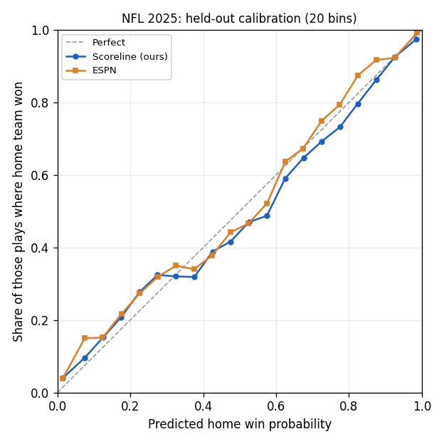

## NFL

**Data.** nflverse play-by-play (CC-BY 4.0, credit: nflverse), regular season and playoffs. Training: 2006-2024 (5,133 games, 814,066 snaps and kickoffs; 2024 was used for early stopping, then folded back in). Held out: the 2025 season (284 games). Pre-game strength: Scoreline's own Elo from nflverse game results since 1999 (k=20, home edge 50 Elo points, 50% regression between seasons; pre-game log loss 0.6297 on 6,200 training-era games). No betting lines are used as inputs.

**Model.** Gradient-boosted trees (LightGBM, 444 trees, 15 leaves, monotone in score margin, strength, field position and timeouts), exported to plain JSON and evaluated in `models/wp.js`. Inputs: score margin, game and half seconds left, overtime, down, distance, yards to the end zone, home/away/neutral, timeouts left for both teams, pre-game strength, strength x time left, margin / time left.

### Held-out 2025: ours vs ESPN on ESPN's own plays

Both models are scored on exactly the same moments: right after each play that ESPN published a win probability for. Our input is built from ESPN's play-by-play the same way the app will build it live.

| Model | Brier (lower is better) | Log loss (lower is better) |
|---|---|---|
| Scoreline (ours) | **0.1621** | **0.4834** |
| ESPN | 0.1634 | 0.4865 |

50,013 plays from 284 games. Brier difference (ours minus ESPN): -0.0013, 95% CI -0.0072 to +0.0048 (bootstrap over games).

| Period | Plays | Brier ours | Brier ESPN |
|---|---|---|---|
| Q1 | 10,308 | 0.2134 | 0.2149 |
| Q2 | 14,338 | 0.1857 | 0.1869 |
| Q3 | 11,039 | 0.1525 | 0.1533 |
| Q4 | 14,041 | 0.1077 | 0.1092 |
| OT | 287 | 0.1779 | 0.1842 |

**Swings check** (change in home win probability from one play to the next, same game):

| Model | Mean change per play | 99th percentile | Plays with a change over 25 points |
|---|---|---|---|
| Scoreline (ours) | 2.13 pts | 16.3 pts | 0.22% |
| ESPN | 2.13 pts | 15.4 pts | 0.26% |

Calibration table (10 bins): predicted vs actual home win share.

| Bin | Ours: predicted / actual | ESPN: predicted / actual |
|---|---|---|
| 0-10% | 3.5% / 5.9% (n=5,542) | 3.4% / 7.5% (n=5,312) |
| 10-20% | 15.0% / 18.0% (n=3,256) | 14.9% / 18.3% (n=3,259) |
| 20-30% | 25.2% / 30.3% (n=3,982) | 25.4% / 29.9% (n=4,160) |
| 30-40% | 35.0% / 31.9% (n=4,151) | 35.1% / 34.5% (n=4,946) |
| 40-50% | 45.1% / 40.3% (n=4,539) | 45.1% / 41.1% (n=5,569) |
| 50-60% | 55.0% / 47.9% (n=5,005) | 54.9% / 49.3% (n=5,482) |
| 60-70% | 65.0% / 61.9% (n=5,185) | 64.9% / 65.5% (n=5,166) |
| 70-80% | 74.9% / 71.2% (n=4,748) | 75.0% / 77.2% (n=4,843) |
| 80-90% | 85.0% / 83.0% (n=4,693) | 85.0% / 89.6% (n=4,131) |
| 90-100% | 96.8% / 96.0% (n=8,912) | 96.9% / 97.2% (n=7,145) |

Latest season alone, the automatic check says: show ESPN's (ours scores slightly better but the gap is within bootstrap noise, so it is not measurably better). The verdict below uses all held-out seasons.

### Rolling backtest: 2023, 2024 and 2025 (each season predicted by a model trained only on earlier seasons)

| Held-out season | Games | Plays | Brier ours | Brier ESPN | Log loss ours | Log loss ESPN |
|---|---|---|---|---|---|---|
| 2023 | 285 | 52,000 | 0.1576 | 0.1525 | 0.4741 | 0.4582 |
| 2024 | 285 | 51,721 | 0.1441 | 0.1447 | 0.4318 | 0.4352 |
| 2025 | 284 | 50,013 | 0.1621 | 0.1634 | 0.4834 | 0.4865 |
| **All 3 pooled** | 854 | 153,734 | **0.1545** | 0.1534 | **0.4629** | 0.4597 |

Pooled Brier difference (ours minus ESPN): +0.0011, 95% CI -0.0029 to +0.0047 (bootstrap over games). Ours is better on both metrics in 2 of 3 seasons.

**Automatic verdict: show ESPN's.** ESPN's numbers score better than ours across the held-out seasons; show ESPN's number, labelled as ESPN's.

### Held-out 2025: ours vs nflverse on nflverse plays (before each snap)

| Model | Brier (lower is better) | Log loss (lower is better) |
|---|---|---|
| Scoreline (ours) | **0.1637** | **0.4876** |
| nflverse wp | 0.1724 | 0.5079 |

43,523 plays from 284 games. Brier difference (ours minus nflverse wp): -0.0087, 95% CI -0.0182 to +0.0003 (bootstrap over games).

| Model | Brier (lower is better) | Log loss (lower is better) |
|---|---|---|
| Scoreline (ours) | **0.1637** | **0.4876** |
| nflverse vegas_wp (uses the betting spread) | 0.1597 | 0.4791 |

43,523 plays from 284 games. Brier difference (ours minus nflverse vegas_wp (uses the betting spread)): +0.0040, 95% CI -0.0016 to +0.0104 (bootstrap over games).
